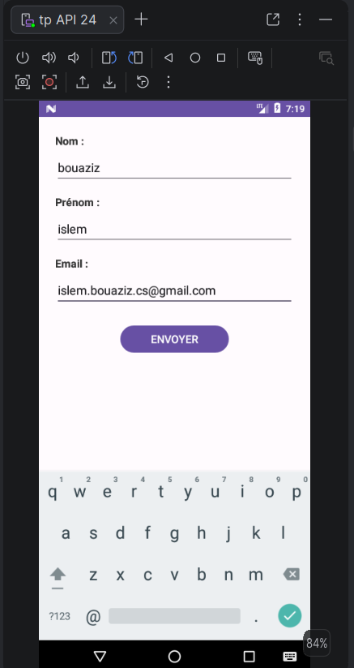
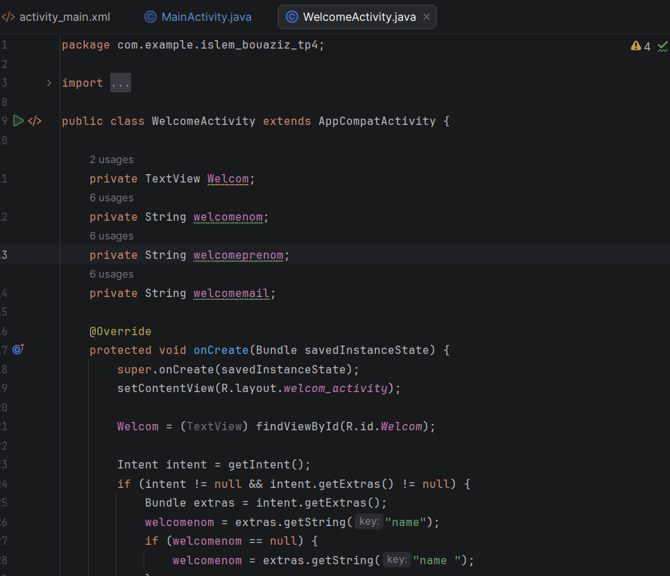

# TP3 : Intents Explicites — « Démarrer un composant de votre application »

**Matière :** Développement Mobile  
**Filière :** LSI3  
**Année Universitaire :** 2026-2027  
**Enseignante TP :** Fourati Héla  
**Étudiant :** Islem Bouaziz  

---

## 🎯 Objectifs

Au terme de ce projet, l'application démontre :
- La navigation et le passage d'une activité à une autre via un **Intent explicite**.
- Le transfert de données saisies d'une activité vers une autre à l'aide des **extras** (`putExtra` et `getExtras`).

---

## 📱 Structure et Fonctionnalités

Le projet est composé de deux activités principales :

### 1. Première Activité (`MainActivity`)
- **Interface graphique (`activity_main.xml`)** : Un formulaire vertical comprenant :
  - Trois champs de saisie (`EditText`) précédés de leurs étiquettes (`TextView`) pour le **Nom**, le **Prénom** et l'**Email**.
  - Un bouton de validation (`Button`) avec le texte **« ENVOYER »**.
- **Logique Java (`MainActivity.java`)** :
  - Récupération des valeurs saisies dans les champs.
  - Instanciation d'un `Intent` explicite ciblant `WelcomeActivity`.
  - Ajout des données en tant qu'extras (`name`, `lastname`, `mymail`).
  - Démarrage de la seconde activité avec `startActivity()`.

#### Captures d'écran — Première Activité

| Interface de Saisie (Activité 1) |
| :---: |
|  |

#### Code Source — `MainActivity.java`

| MainActivity - Partie 1 | MainActivity - Partie 2 |
| :---: | :---: |
|  |  |

---

### 2. Deuxième Activité (`WelcomeActivity`)
- **Interface graphique (`welcom_activity.xml`)** :
  - Un conteneur `LinearLayout` centré.
  - Un `TextView` affichant sous forme de paragraphe les informations transférées.
- **Logique Java (`WelcomeActivity.java`)** :
  - Récupération des extras transmis par l'Intent (`getIntent().getExtras()`).
  - Formatage et affichage du message de bienvenue :
    ```
    Bienvenue [Nom] [Prénom],
    C'est la deuxième activité.
    Vous serez bientôt contacté sur : [Email]
    ```

#### Captures d'écran — Deuxième Activité

| Affichage du Résultat (Activité 2) |
| :---: |
|  |

#### Code Source — `WelcomeActivity.java`

| WelcomeActivity - Partie 1 | WelcomeActivity - Partie 2 |
| :---: | :---: |
|  |  |

---

## 🛠️ Configuration & Exécution

### Prérequis
- Android Studio Ladybug ou version supérieure
- Android SDK (API 24 minimum, target SDK API 34+)
- JDK 17 ou JDK 21

### Installation
1. Cloner le dépôt :
   ```bash
   git clone <URL_DU_DEPOT_GITHUB>
   ```
2. Ouvrir le projet dans **Android Studio**.
3. Laisser Gradle synchroniser les dépendances.
4. Lancer l'application sur un émulateur ou un appareil Android connecté.
